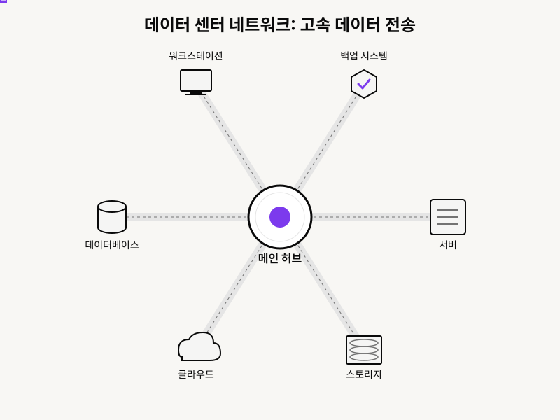
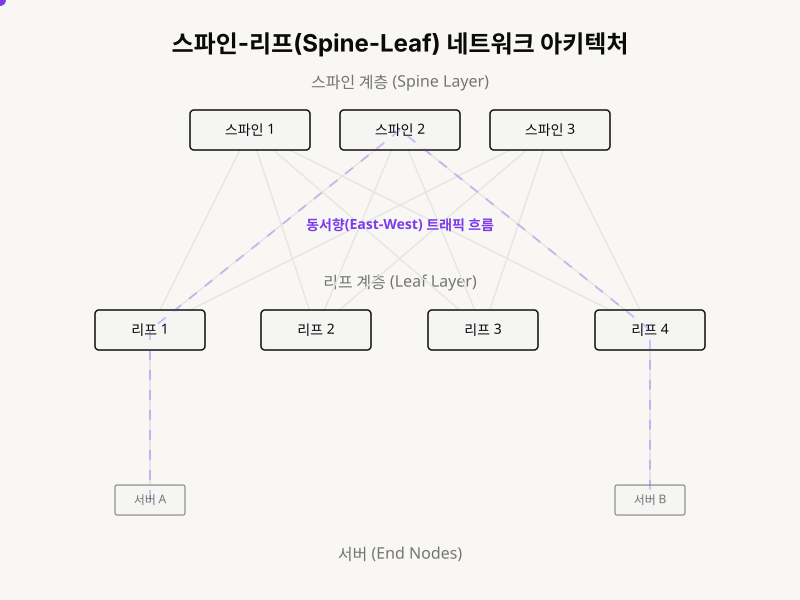

## 데이터 센터 네트워크, 애니메이션으로 쉽게 이해하기!
데이터 센터 네트워크는 우리가 매일 사용하는 인터넷 서비스의 심장 같은 곳이야. 유튜브를 보거나 아마존에서 쇼핑할 때, 우리의 요청은 인터넷을 타고 데이터 센터로 들어가. 그 안에서 수많은 컴퓨터와 저장 장치들이 서로 연결되어 우리가 원하는 서비스를 제공해 주는데, 이 모든 연결을 가능하게 하는 게 바로 **데이터 센터 네트워크**야 . 마치 우리 몸의 신경망처럼, 모든 정보가 빠르고 정확하게 오갈 수 있도록 돕는 중요한 역할을 하지. 지금부터 이 복잡해 보이는 데이터 센터 네트워크가 어떻게 작동하는지, 애니메이션과 함께 쉽고 재미있게 알아보자!

## 1. 데이터 센터 네트워크: 모든 것을 연결하는 고속도로

데이터 센터 네트워크는 서버, 저장 장치, 그리고 다른 여러 장치들을 서로 연결해주는 **초고속 통신망**이라고 보면 돼 . 이 네트워크 덕분에 장치들은 서로 데이터를 주고받고, 사용자들에게 다양한 서비스를 제공할 수 있어. 마치 도시의 모든 건물들이 고속도로로 연결되어 물류와 사람들이 원활하게 이동하는 것과 같지.

- **서버**: 웹사이트나 앱을 실행하는 컴퓨터 
- **스토리지**: 데이터를 저장하는 장치 
- **스위치**: 장치들을 서로 연결해주는 교통경찰 같은 역할 
- **방화벽**: 외부 위협으로부터 네트워크를 보호하는 보안 요원 
이 모든 구성 요소들이 데이터 센터 네트워크라는 고속도로 위에서 유기적으로 움직이며 우리가 원하는 서비스를 제공하는 거야 .

## 2. 스파인-리프 아키텍처: 효율적인 데이터 이동을 위한 설계

전통적인 네트워크는 층층이 쌓인 구조라 데이터가 멀리 돌아가야 할 때가 많았어. 하지만 **스파인-리프 아키텍처**는 이런 문제를 해결하기 위해 나온 현대적인 데이터 센터 설계 방식이야 . 마치 거미줄처럼 모든 길을 서로 연결해서, 어떤 데이터든 가장 빠른 길로 갈 수 있게 해주는 거지.

- **스파인(Spine) 스위치**: 데이터 센터의 **척추** 같은 역할 . 모든 리프 스위치와 연결되어 있어.
- **리프(Leaf) 스위치**: 데이터 센터의 **나뭇잎** 같은 역할 . 서버나 다른 장치들과 직접 연결돼.
이 구조 덕분에 어떤 서버에서 다른 서버로 데이터를 보낼 때도 항상 **리프-스파인-리프**라는 짧은 경로를 통해 빠르게 이동할 수 있어 . 마치 모든 목적지가 고속도로 인터체인지(리프)를 통해 중앙 허브(스파인)로 연결되어 어디든 빠르게 갈 수 있는 것과 같아 .

## 3. vPC: 두 개의 스위치를 하나처럼!

데이터 센터에서는 안정성이 정말 중요해. 만약 스위치 하나가 고장 나면 모든 서비스가 멈출 수 있잖아? **vPC(Virtual Port Channel)**는 이런 문제를 해결하기 위해 시스코 넥서스 스위치에서 제공하는 특별한 기능이야 . 두 개의 스위치를 마치 **하나의 스위치**처럼 작동하게 만들어서, 설령 하나가 고장 나도 다른 하나가 바로 그 역할을 대신할 수 있게 해줘 .

- **피어 링크(Peer Link)**: 두 넥서스 스위치를 연결하는 전용 통신선 .
- **vPC 멤버 포트**: 하위 장치와 연결되는 포트로, 두 스위치에 걸쳐 하나의 논리적인 채널을 형성해 .
이 기술 덕분에 데이터 센터는 **고가용성**을 확보하고, **대역폭 활용**도 훨씬 효율적으로 할 수 있어 . 마치 두 명의 운전사가 한 대의 버스를 교대로 운전하며 승객들을 안전하게 목적지까지 데려다주는 것과 같지.

